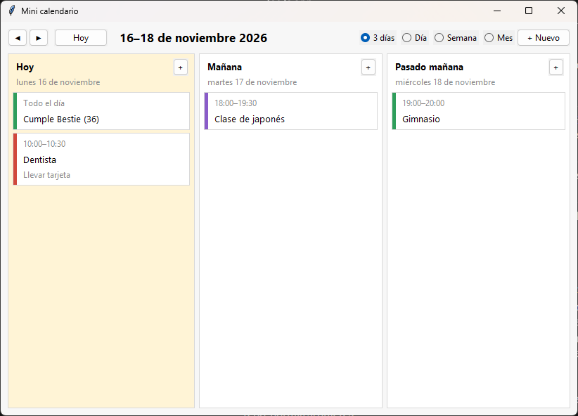
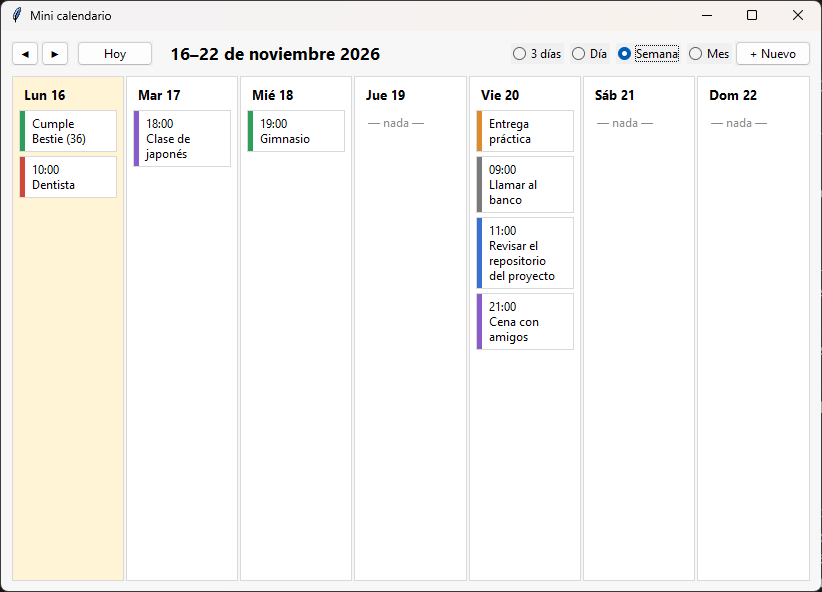
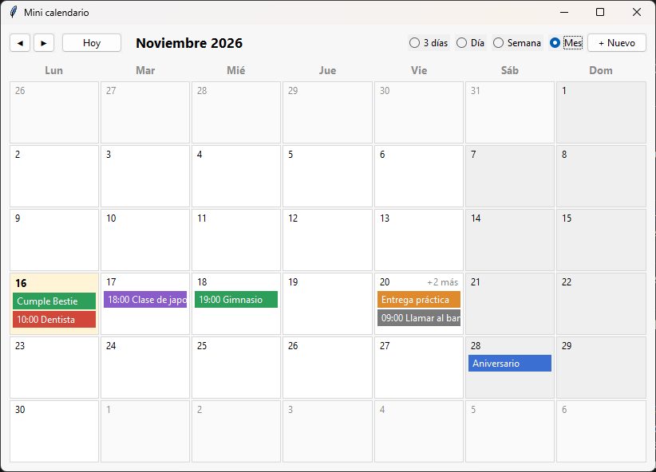

# mini-calendario


A tiny, no-frills desktop calendar that opens when Windows starts, so you can glance at
what's on the next few days, this week and this month. Think *sticky notes with dates*.

- Pure Python, standard library only (`tkinter`). No installs, no accounts, no sync.
- Opens in about 0.3 s and uses about 16 MB of RAM (Task Manager, Windows 11, Python 3.13).
  Exits when you close the window: zero background usage for the rest of the day.
- Events have a title, a date, an optional time range, a colour and a *repeats every year*
  flag for birthdays and anniversaries (optionally showing the age). No alarms, no
  notifications, by design.
- Data lives in a readable `eventos.json` next to the script. Back it up by copying one file.
  If the file gets damaged (e.g. a bad manual edit), the app tells you what is wrong (which
  event, or the line for a syntax error) and doesn't touch the file.

The UI is in Spanish.



## Views

| View | What it shows |
|------|---------------|
| 3 días | Today, tomorrow and the day after (default on launch) |
| Día | A single day |
| Semana | Monday–Sunday columns |
| Mes | Classic month grid; shows as many events per day as fit, plus a "+N más" counter. Click a day to open it |

- ◀ ▶ or the arrow keys move one day (3 días, Día), one week or one month. **Hoy** jumps back to
  today without leaving the current view.
- Click any event to edit or delete it. `+ Nuevo` (or the `n` key) adds one. `Esc` closes the app.
- Long days scroll with the mouse wheel. Long titles wrap to the column width, except in the
  month view, where each event takes one line and is cut off.

| Week | Month |
|------|-------|
|  |  |

## Run it

Requires Python 3.11+ with `tkinter` (included in python.org and Anaconda builds).

```bash
python calendario.pyw
```

On first run `eventos.json` is created automatically. To start with sample data:

```bash
cp eventos.ejemplo.json eventos.json
```

The sample events are around 16–28 November 2026, so navigate there to see them.

## Launch at Windows startup

```bash
python instalar_arranque.py          # creates a shortcut in the Startup folder
python instalar_arranque.py --ver    # check
python instalar_arranque.py --quitar # remove
```

The shortcut runs `pythonw.exe calendario.pyw` (no console window) using the Python
interpreter you ran the installer with. In Task Manager's *Startup apps* it is listed as
`pythonw.exe`.

## Tests

```bash
python -m unittest -v
```

`test_modelo.py` covers the data layer. `test_gui.py` drives the real window: every view,
navigation, the event form, and edge cases (20 events in a day, very long titles and words,
minimum window size, damaged `eventos.json`, times typed as `9:00`). It skips itself when no display is available. GitHub Actions runs both
on Windows and Ubuntu.

## Project layout

```
calendario.pyw          GUI (tkinter)
modelo.py               data model, JSON persistence, date queries (no GUI)
test_modelo.py          unit tests for modelo.py
test_gui.py             GUI tests (need a display)
instalar_arranque.py    Windows startup shortcut installer
eventos.ejemplo.json    sample data
.github/workflows/      CI: tests on Windows + Ubuntu, Python 3.11 and 3.13
```

## How it was built

Built with Claude (Anthropic's AI assistant), which wrote most of the code and tests.
I defined what the app should do, decided on every change, reviewed each one and
tested every version on Windows.

## License

MIT
